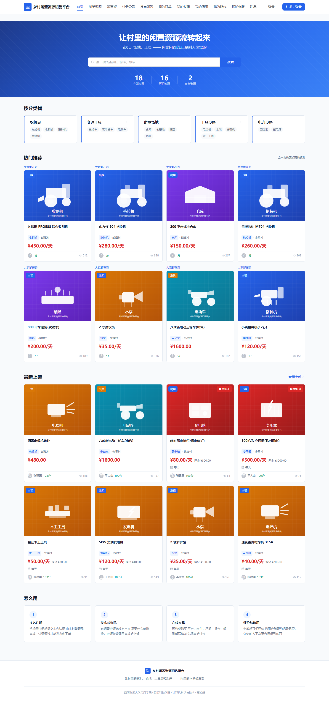
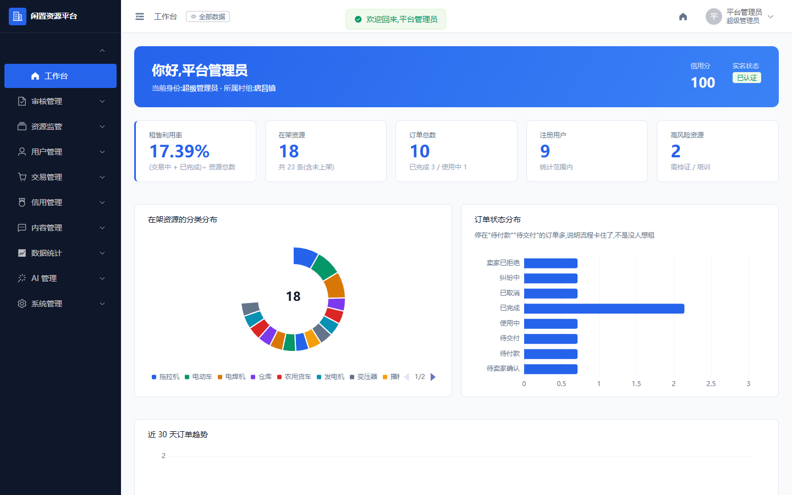
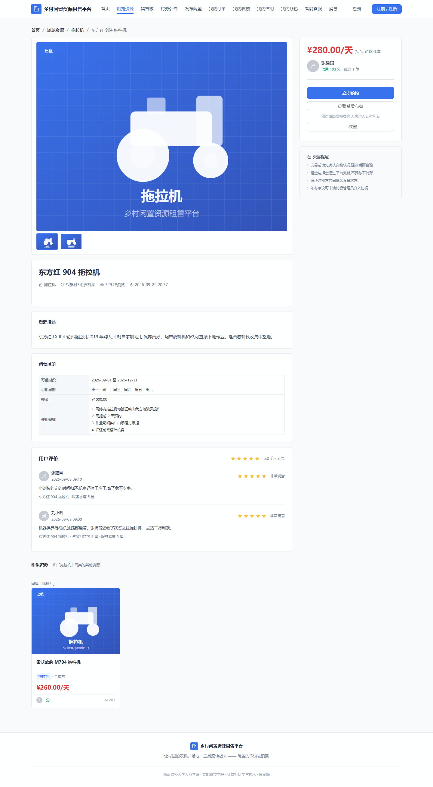
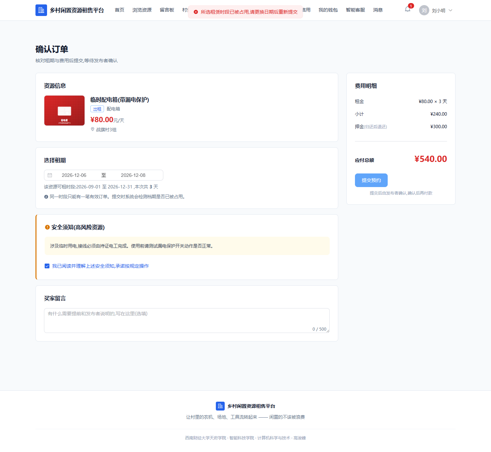
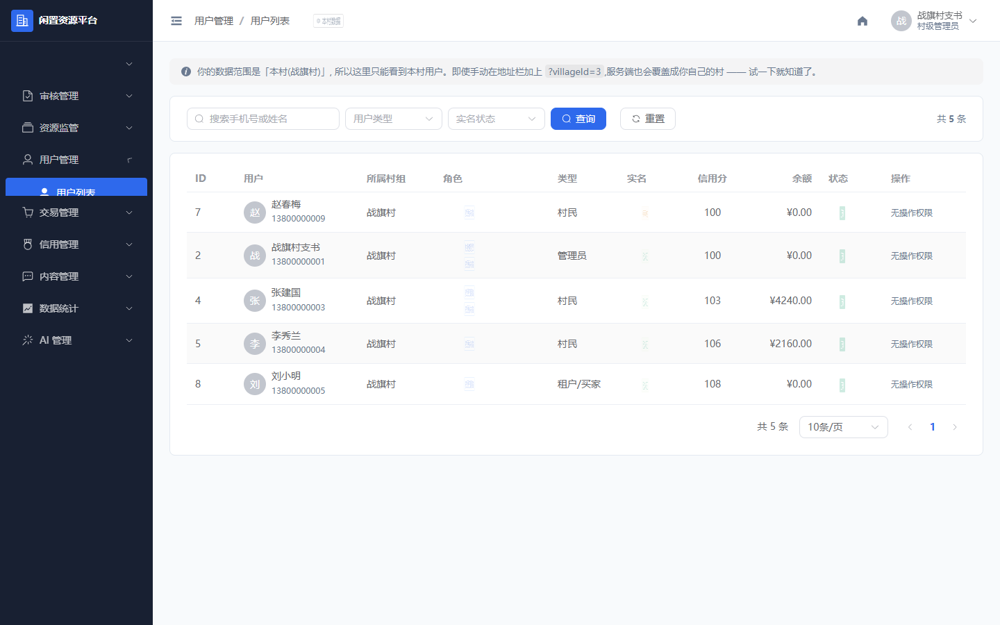
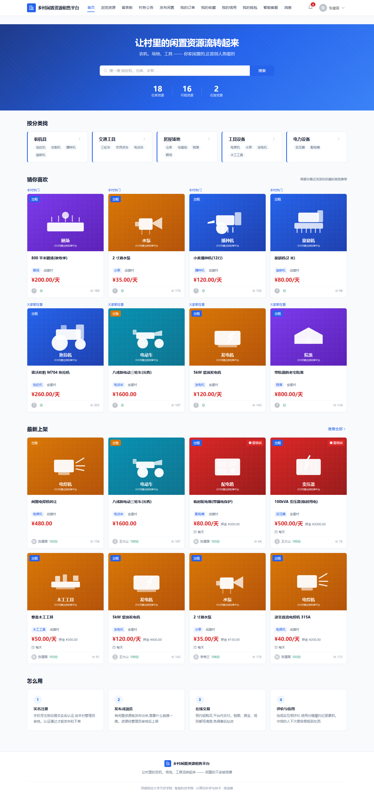

# 乡村闲置资源租售平台

西南财经大学天府学院 · 智能科技学院 · 计算机科学与技术 · 2027 届毕业设计
高浚峰

面向乡村闲置资源(农用机械、交通工具、房屋场地、工具设备)再利用场景的租售交易平台。
覆盖村民(资源发布者)、租户/买家(资源使用者)、村级管理员三类角色,并集成 AI 智能客服与智能推荐。

---

## 界面一览

<table>
<tr>
<td width="50%"><br><sub>前台首页</sub></td>
<td width="50%"><br><sub>后台工作台与数据看板</sub></td>
</tr>
<tr>
<td><br><sub>资源详情,高风险分类自动附带安全提示</sub></td>
<td><br><sub>时段冲突提示:并发下单的第二笔被拒绝</sub></td>
</tr>
<tr>
<td><br><sub>数据级权限:村级管理员只能看到本村用户</sub></td>
<td><br><sub>AI 客服会话与降级记录</sub></td>
</tr>
</table>

---

## 当前进度

| 批次 | 内容 | 状态 |
|---|---|---|
| 0 | 环境 + 前后端骨架 | ✅ 已完成并验证 |
| 1 | 数据库:25 张表 + 4 视图 + 种子数据(收藏表在批次 8 加入,现 26 张) | ✅ 已完成并验证 |
| 2 | 认证与权限(注册登录 / JWT / RBAC 三层) | ✅ 已完成并验证 |
| 3 | 资源模块(发布 / 搜索 / 详情 / 管理) | ✅ 已完成并验证 |
| 4 | 审核流 + 通知 + 敏感词 | ✅ 已完成并验证 |
| 5 | 交易闭环(下单 / 支付 / 状态机 / 事务) | ✅ 已完成并验证 |
| 6a | 评价 + 信用(双向评价 / 信用分 / 信用中心) | ✅ 已完成并验证 |
| 6b | 站内信 + 提现 + 纠纷 | ✅ 已完成并验证 |
| 6c | 留言板 + 公告 | ✅ 已完成并验证 |
| 7 | AI 智能客服(DeepSeek) | ✅ 已完成并验证 |
| 8 | **智能推荐 + 资源收藏** | ✅ **已完成并验证** |
| 9 | **统计 + 部署 + 测试** | ✅ **已完成并验证** |

> **批次 6 为什么拆成三段:** 它原本包含 7 个子模块(评价、信用、站内信、
> 留言板、纠纷、提现、公告),体量是批次 5 的两倍以上,一次交付质量会下降。
> 现在按答辩动线的依赖关系拆开 —— 纠纷要"调取聊天记录",所以站内信
> 必须排在它前面。每一段都能独立跑通、独立验收。

### 批次 9 已验证的能力

接口层 50 项 + 浏览器 32 项 + 部署冒烟 21 项,全部通过。

| 能力 | 说明 |
|---|---|
| **工作台数据看板** | 5 个业务数字 + 分类分布 + 订单状态分布 + 近 30 天趋势,三张 ECharts |
| **村级统计** | 单村的资源/订单/金额/利用率。村管看本村,超管可切村 |
| **全局统计(数据公示)** | 各村横向对比,按租售利用率倒序 —— 公示页要回答的是"谁做得好" |
| **利用率从汇总数重算** | `(使用中+已完成) ÷ 资源总数`,**不是"各村比率的平均"**。一个只有 1 个资源、恰好成过 1 单的村有 100% 利用率,平均进去会显著拉高整体 —— 而这个错**不报错、不崩溃,只是数字悄悄不对**,偏偏它是要写进公示页和论文的那个数 |
| **村管传 `villageId` 也越不了权** | 可见范围只由登录态决定,请求参数只对超管有意义。改 URL 里的村组 id 看不到别村的数字(有专门的接口用例) |
| **超管切村时有默认值** | 超管的 `village_id` 指向镇节点,而资源挂在村上 —— 不给默认值就是一整屏 0,看起来像功能坏了 |
| **全局统计额外判一次超管** | 接口上已有 `@RequiresPerm("stat:global")`,Service 里再判一次:权限码是配出来的、后台能改,而这个接口的语义是"全平台"。改配置就能泄露的路径值得多钉一行代码 |
| **操作日志:失败也记** | 只记成功的话,"有人反复尝试越权删除"在日志里完全看不到 —— 而失败的尝试最该被看见。`status` 两档,失败的那笔还记下异常信息(只存类名+消息,不存堆栈) |
| **日志脱敏,而且是递归的** | 密码、身份证、银行卡、token 按**字段名**打码,不管它藏在第几层。只处理第一层的话 `{"user":{"password":"..."}}` 就绕过去了 |
| **日志里的 IP 取 `X-Forwarded-For`** | 上了 Nginx 之后 `getRemoteAddr()` 拿到的是 Nginx 容器的内网 IP,每个请求都一样、审计价值归零。取转发链的第一个才是真客户端 |
| **操作日志写不进去不影响业务** | 和 AI 行为采集同一条原则:旁路就该有旁路的失败姿态,insert 包在 try 里 |
| **`formatMoney()` 全站统一两位小数** | 后端 `BigDecimal("4240.00")` 经过 JSON 往返会变成 JS 数字 `4240`,渲染出来就是 `¥4240` —— 两个页面对同一笔钱显示出不同的样子,看起来像两笔不同的钱。抽成一个函数全站替换,46 处 |
| **ECharts 按需加载** | 实测:全量引入 1121KB → 按需 571KB,省约 550KB(gzip 178KB)。数字记在 `components/EChart.vue` 的注释里,不是估的 |
| **Docker 一键部署** | `docker compose up -d --build` 起三个容器:MySQL(首次自动建库建表灌演示数据)+ 后端 + Nginx。只有前端暴露端口,跨域问题从结构上不存在 |
| **部署冒烟测试** | `e2e/deploy.mjs`,21 项,打的是容器栈而不是开发环境 —— 验的是"两个分开跑的东西合起来"才会出的问题 |

**部署这一批抓到一个只有部署才会暴露的 bug,值得单独说:**

部署完之后**首页能打开、资源列表也有数据,但一登录就失败**。
原因是同源请求被后端判定成了跨域:前端和服务端都在同一个 Nginx 后面,
浏览器对 **POST** 会带 `Origin` 头,而后端只看得见自己的 8080,
拿它和 Origin 里的 8088 一比 —— 端口对不上,于是 403 `Invalid CORS request`。
**GET 请求浏览器不带 Origin,所以列表、详情全都正常**,唯独登录、下单、
发布这类写操作全军覆没,看起来像"后端接口挂了"。

修法是让后端从 `X-Forwarded-*` 还原请求的真实来源
(`server.forward-headers-strategy: framework` + Nginx 注入
`X-Forwarded-Host/Port/Proto`)。其中 **`X-Forwarded-Port` 必须由 Nginx
从 `$http_host` 里抠出来** —— 容器内 Nginx 监听 80、宿主机映射成 8088,
直接用 `$server_port` 会算出 80,又变回跨域。

`e2e/deploy.mjs` 里为此专门留了两条断言:**同源 POST(带 Origin)不能再被误判**,
同时**真正的跨域来源仍要被拒** —— 修这类问题很容易顺手把 CORS 放开,
那就从"登录不了"变成"谁都能调"。

### 批次 8 已验证的能力

接口层 74 项 + 浏览器 E2E 27 项,全部通过。

| 能力 | 说明 |
|---|---|
| **行为采集** | 六种行为:浏览 / 搜索 / 收藏 / 下单 / 评价 / **推荐位曝光**。浏览由前端上报(只有它知道停留时长和来源),其余四种在服务端顺手记(不写库就做不成) |
| **采集永远不抛异常** | 它是旁路 —— 用户因为"行为记录写不进去"而下不了单是荒谬的。异常全部吞掉并记日志(不是"静默吞异常":日志里有痕,而且采集全挂也只是推荐变笨) |
| **游客不采集** | `user_id` 是非空外键本来就存不下,更主要的理由是隐私:没登录的人只是在看,没理由给他画像。顺带一个好处是**推荐位点击率天然只含登录用户** |
| **分类由服务端查** | 行为记录里的 `category_id` 不接受前端传(可伪造,而且会污染推荐),服务端按资源 id 查 |
| **三路召回** | ① 内容(近 30 天偏好最强的 3 个分类下他没看过的好东西)② 村组热度 ③ 全局兜底。按顺序补位,**任何情况下推荐位都不空** |
| **冷启动不编理由** | 没有行为的用户拿到"本村热门",理由是「本村热门」/「大家都在看」,而不是假的"根据你的兴趣"。标题也跟着变成「热门推荐」 |
| **看过的不会再推** | SQL 里 `NOT EXISTS` 排掉他浏览过的;自己发布的也排除。推一个刚看完的资源是最容易被察觉的"算法很傻" |
| **推荐理由如实** | 写「你关注过「拖拉机」」而不是「你看过」—— 偏好可能来自下单,说"看过"是编的(第一版就是错的,写测试时才发现) |
| **结果缓存 + 主动失效** | TTL 5 分钟,而且**每写一条行为就失效这个用户的缓存** —— 光有 TTL 会出现"刚看完回到首页,推荐还是那一批" |
| **相似资源** | 同分类的其他已上架资源,**不排除看过的**(那是"探索同类"而非个性化,排除会把推荐区搞空) |
| **资源收藏** | 一个接口做双向切换,返回**操作之后**的状态(前端不自己取反)。防重复靠唯一约束 |
| **已下架的收藏不消失** | 收藏列表直接查 `biz_resource` 而不是视图(视图写死了"只看已上架")—— 沿用视图的话,下架的收藏会静默消失,用户以为平台弄丢了 |
| **取消收藏与收藏的先后顺序** | **先判取消**:已下架的资源必须能取消收藏。反过来的话那些收藏就永远删不掉了 |
| **后台推荐效果** | 曝光 / 点击 / 点击率 / 占全部浏览 + 按天趋势 + **行为采集量**(某一种长期为 0 = 那条链路的采集断了) |
| **点击率的埋点闭环** | E2E 真的在浏览器里点一次推荐卡片,再回后台看到点击 +1 —— 这一条穿过详情页上报、`source=4`、后台统计三环,只有真跑才知道通没通 |

### 批次 7 已验证的能力

接口层 70 项 + 浏览器 E2E 35 项,全部通过。

| 能力 | 说明 |
|---|---|
| **业务问答** | 平台真实规则(押金、租期、信用门槛、实名、提现、纠纷、评价、留言板)写进提示词,规则逐条对应代码,不是"大概应该是这样" |
| **提示词纠掉的第一个错** | 没有业务规则时,模型会把押金答成"按租金的一定比例" —— **实测出来的**,而且那句话放在任何租赁平台都成立。加上规则后答"押金是发布者设的固定金额,应付 = 租金总额 + 押金,归还后原路退回" |
| **多轮上下文** | 同一会话取最近 5 轮。判据用**提示 token 变多**来证明上下文拼进去了,不依赖模型措辞 |
| **内容安全 · 入口** | 提问命中拦截类词直接拒绝,**不往外发**:模型列写 `(未调用)`、token=0、耗时=0 —— 三样合起来才是"没出网、没花钱"的证据 |
| **内容安全 · 出口** | AI 的回答命中拦截类词 → 整条丢弃换兜底。**不打码**(和留言板不同):AI 的回答不是证据,把几个词打成星号只会让用户读不通 |
| **三级降级** | AI 成功 → 本地问答库(11 条,和提示词**同一套说法**)→ 通用话术。第二级能覆盖押金、租金、实名、提现这些真实高频问题 |
| **9 种降级归因** | 超时 / 限流429 / 余额不足402 / 鉴权失败401 / 参数错误 / 服务端错误 / 网络异常 / 响应格式异常 / **未配置密钥**。最后一种单独拎出来:密钥没填和密钥不对,处置完全不同 |
| **只重试"可能自愈"的失败** | 连接超时重试(一秒能重连上);**读超时不重试** —— 已经等满 10 秒了,再重试就是让用户等 20 秒 |
| **线程池 + 背压** | core2/max4/queue50/`CallerRunsPolicy`。12 个并发实测**全部成功、全部落库**,排队的不变成错误 |
| **故障注入** | 超管装载一次性失败点,让降级路径可以被重复验证(不再是"改配置重启一次") |
| **后台统计** | 降级率 = 降级 ÷ 总数,失败单独计数;**原因分布**按次数倒序 —— 降级率只说有问题,分布才说该做什么 |
| **会话越权防护** | `sessionId` 由前端生成、可以被伪造,所以取历史时**带 `user_id` 条件**。实测换个人拿同一个 sessionId 蹭不到上下文 |
| **数据级权限** | 村管看本村、超管看全部;跨村标记跟进 403 |
| **关掉思维链** | 实测 completion 241 → 20 tokens、1918 → 1118 ms,而且 `reasoning_content` 不再返回 —— 那个字段有被误展示成回答的风险 |

### 批次 6c 已验证的能力

接口层 185 项 + 浏览器 E2E 77 项,全部通过。

| 能力 | 说明 |
|---|---|
| **公告的可见范围** | 由登录身份决定,不是选出来的:游客只看全平台公告(1 条)、战旗村村民看本村 + 全平台(5 条)、金星村村民看自己那 1 条。页面里没有村组选择器 |
| **全平台公告** | `village_id IS NULL` 即全平台,所有人都看得到,列表上打「全平台」标记 |
| **公告详情越权** | 读不到就是 404(不是 403 —— 403 等于确认"这条公告存在");**失败的访问不给别人刷浏览量**,自增排在权限校验之后 |
| **后台公告管理** | 数据级权限:村管 5 条、超管 7 条;草稿前台不给村民看,后台要能看到才能接着编辑 |
| **公告新建** | 两种出口:「确认发布」立即生效并给能看到它的人发通知;「存草稿」只落库、不发通知、前台看不到。共用 `POST /publish` 一个接口,靠请求体里的 `asDraft` 分叉 —— 存草稿不是一种新能力,它只是"发布公告"这个动作的一个分支 |
| **公告编辑** | 改标题/正文/封面/类型/置顶;去掉封面是真的去掉(逐列 `set`,不靠 `updateById` 的"null 就不更新");**不重发通知** |
| **公告下架 / 重新发布** | 下架后前台立刻读不到、后台仍查得到;下架可逆,重新发布会重盖发布时间并重发通知 |
| **权限码** | 菜单 601 下四个:`announcement:list` / `add` / `edit` / `offline`。「发布已有」复用 `add`(新建和把草稿发出去是同一件事),和 `evaluation:hide` 一个码管「隐藏+恢复」是同一套做法 |
| **「系统公告」只有超管能发** | 前端按角色隐藏这个选项 + 后端 publish 与编辑各挡一道 403,两层都要有 |
| **留言板游客可读、写要登录** | 未登录看得到列表,发帖区位置上显示的是登录提示而不是输入框 |
| **发帖只落本村** | `village_id` 只认登录态,不认前端传的;没绑定村组的账号直接拒绝 |
| **层级压到两级** | 回复也是一条 `biz_board` 记录靠 `parent_id` 指回主帖;**回复的回复会被拒**,正确做法是在回复里点名 |
| **敏感词两级处理** | 拦截类整条拒绝并把命中的词回给用户;替换类**库里存原文 + `is_filtered=1`,读取时才打码**,列表上挂「已过滤」标记 |
| **点赞 toggle** | 用 DELETE 的影响行数判分支(不先查后写);并发重复点赞由 `uk_board_user` 顶掉,计数不重复自增 |
| **计数不丢更新** | `like_count` / `reply_count` 全部在数据库端自增;E2E 的判据是"逐个人问一遍 `liked`,说是的人数必须等于 `like_count`",与落库顺序无关 |
| **回复通知** | `bizType=5` 推给楼主;**点赞刻意不发通知** —— 弱互动会淹掉真正需要对方行动的订单、纠纷通知 |
| **删除连带回复** | 删主帖会连它的回复一起删(不连带的话回复会变成查不到父行的孤儿);逻辑删除,留言可能是纠纷证据 |
| **后台留言巡查** | 只读口径与前台一致(含已隐藏的回复);删除有二次确认,并说清会连带删掉几条回复 |

### 批次 6b 已验证的能力

接口层 102 项 + 浏览器 E2E 52 项,全部通过。

| 能力 | 说明 |
|---|---|
| **我的钱包** | 余额、累计入账、累计提现、审核中四个数字分口径摆开,配完整收益流水与提现记录 |
| **提现申请** | 申请即扣余额并进入审核;`FOR UPDATE` 锁余额行防并发重复提现;驳回时金额退回余额 |
| **后台提现审核** | 打款 / 驳回(驳回原因必填);打款不再动余额 —— 钱在申请时就已经扣走了 |
| **站内信** | 会话按 (双方, 资源) 复用,不存在"发起聊天"按钮;10 秒轮询;打开即标记已读 |
| **聊天敏感词** | 替换类存原文、返回打码版并标注「内容已过滤」;拦截类整条拒绝且不清空草稿 |
| **纠纷申请** | 仅待交付(2)、使用中(3)可申请;同一订单不允许两个未决纠纷 |
| **撤销纠纷** | 只有申请人本人、且管理员尚未受理时才能撤销;撤销后订单恢复原状态 |
| **纠纷处理** | 后台调解抽屉结案(已调解 / 已关闭),订单自动恢复到纠纷前状态 |
| **调取聊天记录** | 后台调解时可读本单私聊原文(含被过滤的原文),默认折叠、展开才发请求 |
| **纠纷不动钱** | 结案只改订单状态;退款走「强制取消订单」、扣分走「信用分调整」,界面上明说 |

### 批次 6a 已验证的能力

接口层 86 项 + 浏览器 E2E 57 项,全部通过。

| 能力 | 说明 |
|---|---|
| **双向评价** | 买家评卖家、卖家评买家各一次;数据库唯一约束 `uk_order_from` 保证一单一评 |
| **三维评分** | 综合评分(必填)+ 资源相符度 + 服务态度;后两项选填,填了才进统计口径 |
| **评价带动信用分** | 好评 +1 / 中评 0 / 差评 -2,与其他来源的加分一样写进流水 |
| **信用等级** | 优秀 ≥120 / 良好 ≥100 / 一般 ≥80 / 较差 ≥60 / 受限 <60,门槛与下单校验对齐 |
| **信用中心** | 信用分、等级、履约率、资源完好率、评价均分 + 完整变动流水 |
| **评价回复** | 只有被评价人能回复,且只能回复一次 —— 差评的申诉通道 |
| **匿名评价** | 数据库保留真实 `from_user_id`,只在展示层脱敏 |
| **后台评价管理** | 巡查差评、隐藏/恢复违规评价;隐藏后立即从信用口径消失 |
| **后台信用管理** | 本村用户信用列表、信用流水、手动加减分(原因必填) |

## 设计取舍

**"为什么这么做"这类内容不在这里展开了**,统一放在
[docs/设计取舍.md](docs/设计取舍.md) —— README 只留"怎么跑、有什么能力、
验证到什么程度",避免它长到没人愿意读。

那份文档现在收了 5 个业务域的取舍:

| 域 | 里面有什么(举例) |
|---|---|
| 交易域 | 为什么 `FOR UPDATE` 必须在校验之前、为什么租赁不改资源状态 |
| 信用域 | 为什么不可变字段不放进 DTO、为什么等级阈值只应有一处定义 |
| 互动域(站内信 / 提现 / 纠纷) | 为什么押金从来没进过卖家余额、为什么撤销纠纷不收集理由 |
| 留言板与公告 | 为什么上锁顺序要定死、为什么读不到的公告返回 404 而不是 403 |
| AI 智能客服 | 为什么提示词是业务规则的唯一副本、为什么 `@Transactional` 不能加在那一层 |

**答辩前请通读它一遍**;论文的"设计权衡"一节可以直接从中取材。

## 目录结构

```
D:\bishe\claude\
├── backend\      Spring Boot 3.5.16 后端(包根 com.gjf.village)
├── frontend\     Vue 3 + Vite 前端
├── sql\          数据库脚本(按顺序执行)
│   ├── 01_schema_sys.sql    用户与权限域 + 系统域(9 张表)
│   ├── 02_schema_biz.sql    资源/交易/互动/AI 域(17 张表)
│   ├── 03_view.sql          4 个视图
│   ├── 04_seed.sql          初始化数据(角色/菜单/用户/分类/敏感词)
│   └── 05_mock_data.sql     演示数据 —— 答辩前必跑
│                             (23 条资源 + 10 笔订单 + 14 条资金流水
│                              + 5 条评价 + 11 条信用流水
│                              + 15 条留言 + 7 条公告 + 12 条 AI 对话)
│                             (收藏与行为记录是跑出来的,不在演示数据里)
├── scripts\      mvn.cmd / mvn.sh / 10 个接口测试脚本 / 2 个辅助脚本
├── docs\         毕设实施方案 + 设计取舍 + 85 张截图
│   ├── 毕设实施方案.md   批次计划、技术选型、测试用例清单
│   ├── 设计取舍.md       每个业务域"为什么这么做"(答辩前通读)
│   └── screenshots\      论文与 PPT 用的截图
├── docker\       容器化部署(一键起整个系统)
│   ├── docker-compose.yml      三个服务:mysql / backend / frontend
│   ├── backend.Dockerfile      两阶段:Maven 编译 → JRE 运行
│   ├── frontend.Dockerfile     两阶段:Node 编译 → Nginx 托管
│   ├── nginx.conf              静态文件 + /api 与 /upload 反代
│   ├── maven-settings-docker.xml  容器内用阿里云源(不是根目录那份)
│   └── .env.example            部署配置模板(复制成 .env)
├── .dockerignore  构建上下文过滤(node_modules / m2repo 不进 Docker)
└── maven-settings.xml   本项目专用 Maven 配置(不改全局)
```

---

## 环境要求

| 组件 | 版本 | 说明 |
|---|---|---|
| JDK | 17 | 本机已装 17.0.9 |
| Maven | **≥ 3.6.3** | ⚠️ 系统 PATH 上的 3.6.1 **不达标**,必须用 `scripts\mvn.cmd` |
| MySQL | 8.0 | 本机已运行在 3306 |
| Node.js | ≥ 20 | 本机 v24.20.0 |

**关于 Maven:** Spring Boot 3.x 要求 Maven ≥ 3.6.3,系统 PATH 上的
`D:\shixun\apache-maven-3.6.1` 不满足。`scripts\mvn.cmd` 会自动切到
`D:\JAVAEE\soft\apache-maven-3.9.5-bin\apache-maven-3.9.5`。
**所有 Maven 命令都用 `scripts\mvn.cmd` 执行**,不要直接用 `mvn`。

---

## 启动步骤

### 1. 初始化数据库(首次或需要重置时)

```bash
cd sql
mysql -u root -p < 01_schema_sys.sql
mysql -u root -p < 02_schema_biz.sql
mysql -u root -p < 03_view.sql
mysql -u root -p < 04_seed.sql
mysql -u root -p < 05_mock_data.sql    # 演示数据(23 条资源)
```

顺序不能变:视图依赖基表,种子数据依赖表结构,演示资源依赖用户和分类。

**演示数据可重复执行** —— 它会先清空业务表并重置自增 ID,
所以每次重跑得到的数据完全一致(资源 ID 稳定在 1-23),
论文截图和接口测试里引用的编号不会失效。

### 2. 启动后端(端口 8080)

**首次要先配 DeepSeek 密钥**(批次 7 的智能客服需要;不配也能启动,
只是所有问答都会走兜底话术):

```bash
cd backend/src/main/resources
cp application-dev.yml.example application-dev.yml    # 首次
# 然后把里面的 app.ai.deepseek.api-key 填上
```

密钥从 <https://platform.deepseek.com> 拿(需要先充值,没有可长期用的免费额度)。
`application-dev.yml` 里有数据库密码、AI 密钥和 JWT 签名密钥,**已被 `.gitignore`
挡在仓库外** —— 仓库里那份是 `application-dev.yml.example`,只有占位符。

JWT 那项同样不在仓库里:`application.yml` 写的是 `${JWT_SECRET:}`,真实值放在
`application-dev.yml`(本地开发)或环境变量 `JWT_SECRET`(部署)。所以 Docker
部署时 `docker/.env` 里的 `JWT_SECRET` **必须填**,否则容器起不来。

配好之后可以用自检接口确认(**它不消耗 token**):

```bash
curl http://localhost:8080/api/ping/ai
# 期望看到 "AI 配置正常,可用模型:[deepseek-flash, deepseek-v4-pro]"
# 如果模型名配错了,这里会明确告诉你 —— 对话接口是不会报错的
```

```bash
cd backend
..\scripts\mvn.cmd spring-boot:run
```

### 3. 启动前端(端口 5173)

```bash
cd frontend
npm install     # 首次
npm run dev
```

浏览器打开 http://localhost:5173

### 4. 接口文档

后端启动后访问 http://localhost:8080/swagger-ui.html

### 5. Docker 一键部署(整个系统)

上面 1~3 步是**开发环境**:三个东西各起各的。要在一台干净机器上
把整个系统跑起来,用这个 —— 它不依赖本机的 JDK / Maven / Node / MySQL,
只要有 Docker。

```bash
cd docker
cp .env.example .env      # 填 DB_ROOT_PASSWORD 和 DEEPSEEK_API_KEY
docker compose up -d --build
```

浏览器打开 **http://localhost:8088**(端口在 `.env` 的 `WEB_PORT` 里改)。

起来的是三个容器:

| 容器 | 作用 | 端口 |
|---|---|---|
| `village-mysql` | MySQL 8.0,**首次启动自动建库建表灌演示数据** | 不对外 |
| `village-backend` | Spring Boot 接口 | 不对外 |
| `village-frontend` | Nginx:托管页面 + 反代 `/api`、`/upload` | `8088` |

**只有前端暴露端口** —— 浏览器只访问一个地址,跨域问题从结构上就不存在。
数据库的初始化脚本就是 `sql/` 下那五个,**按文件名顺序自动执行**,
所以演示数据也是自动就位的,不需要手工 `mysql < 05_mock_data.sql`。

常用操作:

```bash
docker compose ps              # 看三个容器的健康状态
docker compose logs -f backend # 跟后端日志
docker compose down            # 停止(数据保留在卷里)
docker compose down -v         # 停止并清空数据(下次会重新初始化数据库)
```

**首次构建比较慢**(要下 Maven 依赖和 npm 包,各两百兆左右),之后
改代码再构建会走缓存。**`.env` 不要提交** —— 它和 `application-dev.yml`
一样被 `.gitignore` 挡着,仓库里只有 `.env.example` 模板。

> 国内拉镜像的坑:docker.io 直连不通,部分加速源的 blob 会卡住不动,
> 可用的路径和判断过程记在 `docs/设计取舍.md` 的「容器化部署」一节。

---

## 验证

二十一个脚本,前后端都启动后运行。它们同时也是论文「系统测试」章节的素材来源。

> `e2e/deploy.mjs` 是个例外:它打的是 **Docker 栈**(`http://localhost:8088`),
> 不需要起开发环境的 5173 / 8080,但需要 `docker compose up -d` 先跑起来。
> 它验的不是"功能对不对",而是"这套东西在容器里合起来能不能用" ——
> 详见下面的说明。

| 脚本 | 覆盖 | 项数 |
|---|---|---|
| `python scripts/api_test.py` | 认证与权限(接口层) | 22 |
| `python scripts/api_test_resource.py` | 资源模块(接口层) | 48 |
| `python scripts/api_test_audit.py` | 审核 / 通知 / 敏感词(接口层) | 67 |
| `python scripts/api_test_order.py` | 交易闭环(接口层) | 92 |
| `python scripts/api_test_credit.py` | 评价 + 信用(接口层) | 86 |
| `python scripts/api_test_interact.py` | 站内信 + 提现 + 纠纷(接口层) | 102 |
| `python scripts/api_test_board.py` | 留言板 + 公告(接口层) | 185 |
| `python scripts/api_test_ai.py` | AI 智能客服(接口层) | 70 |
| `python scripts/api_test_recommend.py` | 智能推荐 + 收藏(接口层) | 74 |
| `python scripts/api_test_stat.py` | 数据统计 + 操作日志(接口层) | 50 |
| `cd frontend && node e2e/permission.mjs` | 认证与权限(浏览器) | 23 |
| `cd frontend && node e2e/resource.mjs` | 资源模块(浏览器) | 28 |
| `cd frontend && node e2e/audit.mjs` | 审核 / 通知 / 敏感词(浏览器) | 34 |
| `cd frontend && node e2e/order.mjs` | 交易闭环(浏览器) | 36 |
| `cd frontend && node e2e/credit.mjs` | 评价 + 信用(浏览器) | 57 |
| `cd frontend && node e2e/interact.mjs` | 站内信 + 提现 + 纠纷(浏览器) | 52 |
| `cd frontend && node e2e/board.mjs` | 留言板 + 公告(浏览器) | 77 |
| `cd frontend && node e2e/ai.mjs` | AI 智能客服(浏览器) | 35 |
| `cd frontend && node e2e/recommend.mjs` | 智能推荐 + 收藏(浏览器) | 27 |
| `cd frontend && node e2e/stat.mjs` | 数据统计 + 操作日志(浏览器) | 32 |
| `cd frontend && node e2e/deploy.mjs` | **部署冒烟测试**(打 Docker 栈的 8088,不是开发环境) | 21 |

**合计 1218 项检查。**

> 前端那十个浏览器脚本**共享同一份数据,而且会互相改写**,所以必须
> **一个一个单独跑**,每个脚本之前先重置一遍演示数据(见本节末尾的注意事项)。
> 不要串成一条命令:比如 `order.mjs` 会给张建国打款,后面 `interact.mjs`
> 断言的种子余额(4240)就对不上了;`board.mjs` 既断言公告条数、自己又会发公告,
> 重跑不重置同样会多出来。
> 想单独跑某一个,就用上表里的 `node e2e/xxx.mjs`。
> `deploy.mjs` 打的是 Docker 栈,和这十个互不影响 —— 用 `npm run e2e:deploy`。

**接口层**验证:登录鉴权、未登录拦截、菜单差异、按钮级 403、数据级过滤与越权尝试、
注册查重、全文检索、父分类展开、多条件筛选、详情可见性、发布闭环、状态机、文件上传、
实名审核流转、资源审核流转、通知必达与越权拦截、DFA 过滤效果与词库热更新、
下单前置校验、金额计算、时段冲突、并发防超卖、订单状态机与越权、资金与信用记账、
购买类流程、取消与拒绝、后台强制取消、事务回滚、
评价前置校验与一单一评、双向评价的信用分变动、评价回复权限、匿名脱敏、
信用等级与 NULL 语义、流水链自洽、后台隐藏评价对信用口径的即时影响、手动调分、
钱包口径与流水自洽、并发提现防超扣、提现审核与驳回退款、
会话复用与越权读取、聊天敏感词双档处理、
纠纷申请前置校验(状态区间 / 未决去重)、撤销权限与订单恢复、后台调解结案与聊天记录调取、
公告的四种可见范围与详情越权 404(失败访问不刷浏览量)、草稿不进前台、
公告的**新建发布 / 存草稿 / 编辑 / 下架 / 重新发布**五个写动作与数据级权限、
「存草稿不发通知、发布才发」的通知数对比、**编辑时的批量赋值尝试**
(请求体里塞 villageId / publisherId / viewCount 都被忽略)、
留言板的游客读/登录写、两级层级约束(回复的回复被拒)、敏感词两级处理与读取时打码、
**5 个不同用户并发点赞同一条帖**(死锁回归用例)、计数与明细对账、删除连带回复、
AI 问答的参数校验与落库(token 用量、耗时、模型名)、多轮上下文(判据是提示 token 变多)、
**入口内容安全("提问被拦下"要能证明没出网、没花钱)**、三级降级(注入失败点走真实降级路径)、
降级率的口径自洽(成功+降级+失败=总数、降级率=降级÷总数)、原因分布按次数倒序、
数据级权限(村管只看本村)、**会话越权(换个人拿同一个 sessionId 蹭不到上下文)**、
标记已解决的归属校验、**12 个并发提问全部有业务响应且全部落库**、
统计的口径自洽(**平均利用率必须是"总出租数÷总资源数"从汇总数重算,
而不是"各村利用率的平均"** —— 后者是典型的统计错误,不报错、不崩,
只是数字悄悄不对,而它是公示页和论文里要引用的那个数)、
统计的数据级权限(村管看本村、超管看全部)、**村管传 `villageId` 也越不了权**
(范围由身份决定,请求参数被忽略)、
操作日志的写入(**成功和失败各记一笔**、失败的记下异常信息)、
**日志脱敏(密码、身份证不出现在 params 里)**、日志的模块/状态/操作人筛选。

**浏览器端到端**用 Playwright 驱动系统已装的 Edge(不额外下载浏览器),
真实点击、真实填表、检查渲染结果 —— 验证的是「编译通过」验证不了的东西。
交易那套用例会完整走一遍"选租期 → 下单 → 卖家确认 → 支付 → 交付 → 归还",
并逐帧检查按钮是否随状态正确切换;评价那套会走"提交评价 → 评价上墙 →
被评价人信用分 +1 → 回复评价 → 后台隐藏/恢复";
**互动那套验证的是"同一份数据在不同人眼里不一样"** ——
同一笔流水在不同角色下方向不同、同一个纠纷在申请人和被申请人眼里按钮不同、
同一段聊天原文当事人看到打码版而管理员看到原文。
**留言板那套验的是"可见范围不是选出来的"** —— 同一个 `/announcement` 页面,
游客、本村村民、别村村民各看到不同的条数,页面里没有任何村组选择器;
「系统公告」这个选项在村管的发布对话框里**根本就不存在**;
后台那一套会把公告走一遍"编辑 → 下架 → **换个人登录确认前台真的看不到了** →
重新发布 → 换个人登录确认又出现了";末段再走一遍"**填好先存草稿 → 换个人
登录确认前台看不到 → 回到后台从列表上发布 → 再换个人登录确认看到了**"。
最后那几趟"换个人登录"是这段的关键:
只改一个自己看得见的标签,和真的让它在别人眼里消失,是两件事。
这一类差别如果只靠接口测试,`v-hasPerm` 把选项删掉了是看不见的 ——
**"因人而异"只在渲染层成立,接口测试证明不了它。**

**AI 那一套验的是"降级在界面上长什么样"** —— 接口测试能证明 `status=2`,
证明不了那个标记有没有摆对;而用户判断"这是不是 AI 说的"靠的正是它。
所以它会把三个状态各走一遍:正常回答挂的是「这个回答解决了我的问题」、
兜底答复挂的是带原因的「兜底答复」标签、提问被拦下挂的是「内容被拦下」。
后台那一段则验证降级率与原因分布渲染正确、「只看降级和失败」筛选有效,
以及标记人工跟进之后按钮变成「已标记」。

**统计那一套验的是"这一页上的数字到底是不是那个数"** ——
统计页面很容易做到"看着有数就算过":随手查点什么往表格里一填,
页面上一样有数字、一样能截图。所以这一套不看"有没有",只看"对不对":
村级统计的利用率那一格是不是百分比、**切到没有资源的村时数字是否真的变成 0
(而不是留着上一个村的数)**、全局统计的各村明细有没有把镇节点混进去
(唐昌镇是三个村的合计,混进"各村对比"里比谁都差,而且看起来特别合理)、
明细表是不是按利用率倒序(公示页要回答的是"谁做得好")、
**没有数据时图表容器仍然在**(整块消失的话用户会以为是页面坏了)。
权限那一段则是**同一个 URL 换个人登录就看不到** —— 村管的菜单里
「全局统计」和「操作日志」根本不存在(没有「系统管理」整个目录),
直接敲 `/admin/stat/global` 后端返回 403。

**会自动截图到 `docs/screenshots/`**,可直接用于论文和答辩 PPT。

### E2E 的等待怎么写(踩过的坑)

**不要用固定等待,也不要等"容器"或"空状态"** —— 这两条都试过,都是错的。

这批页面(Vue + Element Plus)都是"先渲染骨架、再由 `onMounted` 发请求、
回来才填内容"的结构,而**骨架里已经包含了容器和空状态**:

| 看着很稳妥的等法 | 为什么错 |
|---|---|
| `waitForTimeout(1800)` | 开发服务器是现场编译 `.vue` 的,首次加载某个组件时不够用 |
| 等根节点 `.board-page` / `.notice-page` | 它第一帧就在,请求还没发出去 |
| 等空状态 `.el-empty` | `loading` 的初始值是 `false`,所以"空"在第一帧就成立 |
| 等 `v-loading` 遮罩消失 | 遮罩在加载开始前还没被创建,一样会提前满足 |
| 等元素"消失"(如"标题不在了") | 空页面上它当然不在 —— 断言变成了恒真 |

**唯一可靠的判据是"数据元素出现了没有"**:`.article-title` / `.post .content` /
`.notice-item` / `.el-table__body tr` —— 这些在请求回来之前**不存在**。

一个反例:有一处要断言的是"**请求回来了但页面上什么都不该出现**"
(越权读公告)。这种场景没有元素可等,只能等接口那次响应
(脚本里的 `waitApi`),然后给渲染留一拍。

这类坑的代价不只是"偶尔红一次":它让断言以"还没来得及渲染"为理由
**通过或失败**,两种方向都会发生 —— 连跑 11 轮踩到 2 次,而且每次
失败的位置都不一样。把等待判据全部换掉之后,连续跑 14 轮零失败。
(之后又发现了另一类偶发,原因不同,见下一节。)

### 前提要自己确认,别指望断言替你去发现

还有一类偶发,原因和"等得不够"不同,但表现一样:它是**前提没成立**。

场景是"游客视角"那一段:先 `goto('/')` + `localStorage.clear()`,再打开留言板。
问题在于 `localStorage.clear()` 清掉的是**存储**,不是**已经在内存里的登录态** ——
如果紧接着那次导航没有让应用重新启动(或者应用启动得比 clear 晚),
页面会停在一个中间状态:**Pinia 里还登录着,但后续请求已经不带 token**。
表现为发帖框还在(所以看不到「游客可以浏览」那句提示),
而留言列表因为拿不到村组直接失败(所以一条留言也读不到)。

这个状态最坏的地方不是它失败,而是它**失败得像两个互不相干的问题** ——
"读不到留言"和"提示语不对",排查时会被引到完全没问题的代码上。
所以脚本里把"确实是游客"提成了一个独立的前提(`gotoAsGuest`),
确认不到就重试,三轮还不行就报一条指向登录态清理的失败。

**判断依据:那件事是不是本节要验的对象。**
"游客看到几条留言"要验,"我现在是不是游客"只是前提 ——
前提就该自己确认掉,而不是让它伪装成断言失败。
把这一条也处理掉之后,连续跑 10 轮零失败。

### 测 AI 的东西,判据不能落在模型的措辞上

这一批的断言写错过两次,两次都是同一个原因:**拿模型的措辞当判据。**

| 写错的断言 | 为什么错 |
|---|---|
| 回答里不许出现「比例」 | 提示词生效后模型说的是"**不是**按租金比例算的" —— 它提到了那个词,但恰恰是在否定。最正确的那条回答被判成了失败 |
| 追问的回答里要有「退」字 | 模型完全可能说"原路**返还**"。同样接住了上文,措辞不同而已 |
| 对照组断言"回答里出现了他的名字" | 模型可以答"你说你住战旗村三组"而不重复姓名,那句同样证明上下文通了 |

改成不依赖措辞的判据之后稳定了:

- 押金那条 → 判断有没有**肯定**那个错误说法(正则匹配否定式),同义词也要接受
- 上下文那条 → 用**提示 token 变多**来证明上下文拼进去了。这是机制层面的
  确定性证据:"多一轮问答就多几十个 token",和模型怎么说话无关
- "没出网"那条 → 用 `模型列 = (未调用)` + `token = 0` + `耗时 = 0`
  三个可验证的事实,而不是"回答里有没有说拒绝"

**一句话:能断言机制的地方别去断言措辞。** 措辞是模型每次都会变的东西,
把断言压在它上面,等于给测试加了一个随机数。

### 辅助检查

```bash
python scripts/check_view_paths.py
```

检查数据库里的菜单组件路径与前端 `.vue` 文件是否一一对应。

**为什么需要它**:后台页面走动态路由,组件路径是数据库里的一列字符串。
路径写错时前端**不会报错**,而是静默回退到占位页 ——
表现为"这个菜单点进去是空的",靠肉眼排查很费时间。
(这个坑实际踩过一次:文件建成了 `realname.vue`,而数据库里写的是
`admin/audit/realname/index`。)

### 注意事项

- 接口测试会注册用户、发布资源、执行审核、下单支付、提交评价 ——
  **跑完请重新执行 `sql/05_mock_data.sql` 恢复干净的演示数据**。
- **每个脚本跑之前都要先重置,不要背靠背连着跑。** 这些用例里有不少断言
  依赖演示数据的精确状态(比如"待审核资源恰好 2 条"),上一个脚本改了数据、
  下一个就可能对不上。脚本本身没问题,只是它们共享同一份数据。
  唯一可以连着跑的是 `api_test` → `api_test_resource` → `api_test_audit`
  这一组,它们的前置数据互不冲突。
- **创建订单/评价的脚本尤其必须先重置**:上一轮留下的订单会占住测试档期,
  让冲突检测用例连锁失败;上一轮提交的评价会让"一单一评"用例误报。
  `api_test_order.py`、`api_test_credit.py`、`e2e/order.mjs` 里都加了前置检查,
  遇到这种情况会直接提示你去重置,而不是抛一堆看不懂的错。
- 该脚本会重建一个**自洽**的快照:不只重建业务数据,也会把用户状态、
  余额、信用分、审核流水、通知、评价一并按订单重新算出来。
  否则会出现"审核列表里挂着待办、用户页面却显示已驳回",
  或者"余额 1280 元但没有任何流水能解释它从哪来"这种自相矛盾的数据。
  脚本末尾有 **7 条一致性校验查询**,跑完请看一眼是否都是 0 行。
- **测试账号会按白名单清理**:`05_mock_data.sql` 只保留 `138000000*` 号段的
  演示账号,其余一律删掉。不这么做的话,跑几轮测试就会攒出一批"测试用户",
  把演示账号挤出后台列表的第一页 —— 看起来像数据被污染了。
- **`api_test_ai.py` 和 `e2e/ai.mjs` 会真实调用 DeepSeek**(每次提问几十个 token),
  也会往 `ai_chat_record` 里写记录。它们和别的脚本一样必须先重置 ——
  降级率是"降级 ÷ 总数",上一轮留下的记录会把分母撑大,断言就对不上了。
  好在 `05_mock_data.sql` 会清掉这张表(它也是只增不改的,不清就会一轮一个数)。
- **AI 那两个脚本里有几条断言依赖"环境正常"**:比如"第一次提问应当拿到真实回答"。
  外呼接口偶发一次超时是环境的事,不是产品的事 ——
  `e2e/ai.mjs` 遇到这种情况会自动再问一次(实测十几轮撞到过一次);
  而"降级本身有没有被正确表达"是**注入式**用例专门验的,两件事分开。
- Playwright 的全页截图对 sticky/fixed 定位元素偶尔会有拼接伪影(元素出现在错误位置)。
  以视口截图或实际浏览器为准,不要以全页截图判断布局问题。

---

## 测试账号

所有账号密码统一为 **123456**。

| 手机号 | 姓名 | 角色 | 说明 |
|---|---|---|---|
| 13800000000 | 平台管理员 | SUPER_ADMIN | 全平台权限,可见全部菜单 |
| 13800000001 | 战旗村支书 | VILLAGE_ADMIN + VILLAGER | 只能看战旗村数据(演示数据级权限) |
| 13800000002 | 先锋村主任 | VILLAGE_ADMIN | 只能看先锋村数据 |
| 13800000003 | 张建国 | VILLAGER + BUYER | 村民兼买家,演示数据里他的"待我处理"有单子 |
| 13800000004 | 李秀兰 | VILLAGER | 村民,收益最多(卖出了一台旋耕机) |
| 13800000005 | 刘小明 | BUYER | 买家,完成过 3 笔订单 |
| 13800000006 | 陈晓芳 | BUYER | 先锋村买家 |
| 13800000007 | 王大山 | VILLAGER | 金星村村民(演示跨村交易) |
| 13800000009 | 赵春梅 | VILLAGER | **实名待审核**,用于演示审核流 |

**权限差异演示:** 平台管理员可见 9 个目录 / 50 个菜单项;
村级管理员只能看到 8 个目录 / 36 个菜单项,没有"系统管理"整个目录。

**信用分与余额不是编出来的:** 演示数据里每个人的分数和余额都能追溯到
真实的订单和流水。演示时被问"这 109 分怎么来的",能直接打开信用流水
一条条给他看:

| 用户 | 信用分 | 余额 | 构成 |
|---|---|---|---|
| 刘小明 | 109 | 0 | 100 + 3 笔履约(+6)+ 3 条好评(+3) |
| 李秀兰 | 106 | 4160 | 100 + 2 笔履约(+4)+ 2 条好评(+2) |
| 张建国 | 103 | 2490 | 100 + 1 笔履约(+2)+ 1 条好评(+1) |
| 王大山 | 100 | 4000 | 有 4 笔订单但一笔都没走完,所以还是初始分 |

**评价演示数据里刻意留了两条"半成品"**:
订单⑧的卖家还没评价(演示"待评价"入口)、李秀兰收到的一条 4 星评价
还没回复(演示"回复差评"这条申诉通道)。

---

## 技术选型说明

| 层 | 选型 | 为什么 |
|---|---|---|
| 后端 | Spring Boot **3.5.16** | 原计划 3.2,但 3.2.x 已停止开源维护(末版 3.2.12 / 2024-11),答辩会被追问 |
| ORM | MyBatis-Plus 3.5.17 | 需额外引 `mybatis-plus-jsqlparser`(3.5.9 起分拆) |
| 鉴权 | JWT + 拦截器 + AOP | 未用 Spring Security:本系统无 OAuth2/表单登录需求,配置成本不划算 |
| 连接池 | HikariCP | Spring Boot 自带;Druid 在 Boot 3 下需换专用 starter |
| 前端 | Vue 3 + Vite 8 | |
| AI | DeepSeek `deepseek-flash` | 模型名写在配置里,可随时替换。**注意模型名写错不会报错** —— 服务端会静默回退到默认模型,所以启动时会把生效模型打进日志 |
| AI 调用 | JDK 自带 `HttpClient` | 不引额外依赖;支持连接超时(3s)和读取超时(10s)分开设。和连接池选 HikariCP 而不是 Druid 是同一个判断 |
| AI 线程池 | `ThreadPoolExecutor`(core2/max4/queue50) | 别让几十个 Tomcat 线程一起站在门口等一个外部接口 |

---

## 已知问题与注意事项

### 必须知道的坑

1. **JDBC 的 `characterEncoding` 要写 `UTF-8`,不能写 `utf8mb4`**
   写错会抛 `SQLException: Unsupported character encoding 'utf8mb4'`,连接建不起来。
   前者是 Java 字符集名,后者是 MySQL 字符集名。

2. **从实训项目平移代码时,`javax.*` 全部要改成 `jakarta.*`**
   Spring Boot 3 换了命名空间,不改编译直接不过。

3. **DeepSeek 的模型 ID 变更过两轮**
   `deepseek-chat` / `deepseek-reasoner` 已于 2026-07-24 退役,当前用 `deepseek-flash`。
   启动批次 7 前请再核对一次官方文档。

4. **后台路由必须走 `addRoute` 动态注册**
   做成静态路由再靠菜单隐藏的话,手敲 URL 就能进任何后台页面。

5. **`el-date-picker` 配了 `value-format` 后拿到的是字符串,不是 Date**
   直接写 `(end - start) / 86400000` 会得到 `NaN`。而 `NaN` 参与比较
   一律返回 `false` —— 于是"天数 ≤ 0 就禁用提交"这道校验被悄悄绕过,
   页面显示着 `¥NaN` 却还能提交。必须显式 `new Date()` 再算。
   (这个 bug 接口测试测不出来,是浏览器的端到端用例抓到的。)

6. **`FOR UPDATE` 必须在任何校验之前获取**
   先校验再加锁等于没加锁 —— 校验用的是加锁前的旧数据,两个并发请求
   会双双通过"没有冲突"的检查,然后各自插入订单。这是典型的
   检查后使用(TOCTOU)竞态,只有锁能根治。

7. **多线程测试脚本要防"上一轮的脏数据"**
   会创建真实数据的用例重复跑之前必须先重置,否则第一处失败会
   连锁触发几十处失败,报错看起来像是产品坏了。
   给脚本加一道前置检查,让它直接说出"请先重置",比事后排查便宜得多。

8. **演示数据脚本的清理范围要按白名单,不能按号段**
   最初只清 `137%`(当时的测试脚本用这个号段),后来新增的脚本改用
   `139` 号段,账号就开始悄悄累积 —— 攒到 11 个用户之后,
   后台信用列表的第一页装不下,演示账号被挤到第二页,
   E2E 里"找得到刘小明"这条断言随机失败。
   改成"只保留 `138000000*` 的演示账号"之后,测试脚本无论用什么号段都不会漏。

9. **`0%` 和"无数据"必须在服务端区分开**
   视图里对没有数据的比率用 `IFNULL(..., 0)` 兜底,结果一个刚注册的用户
   履约率显示 `0%` —— 他什么都没做错,却看起来像信用崩了。
   改成返回 `NULL`,前端渲染成"暂无数据"。**这个区分只能服务端做**:
   前端拿到 0 是分不清"真的是 0"还是"没有数据"的。
   (注意 Jackson 配了 `non_null`,`null` 字段会整个消失 ——
   前端用 `field == null` 判断,`undefined == null` 同样成立。)

10. **E2E 里不要用 `waitUntil: 'networkidle'`,也不要用固定 sleep**
    Vite 开发服务器带 HMR 长连接,`networkidle` 会偶发
    `net::ERR_ABORTED`;固定 sleep 则在首次访问某个路由时不够用
    (Vite 要现编译组件)。正确做法是 `domcontentloaded` + 带重试的跳转,
    以及 `waitForSelector` 等目标元素出现。
    **这个坑只在连着跑多个 E2E 脚本时才暴露**,单独跑怎么都过 ——
    排查时先怀疑测试基础设施,不要先怀疑产品代码。

### 安全提醒

**批次 7 起,`application-dev.yml` 已经被 `.gitignore` 挡在仓库外了。**
这个文件里现在有两样不该进公开仓库的东西:数据库密码,和 DeepSeek API Key。
之前那套"上传前记得把 password 改成 `${DB_PASSWORD}`"的做法,
在只有一处秘密时还靠得住;多出第二处之后,靠"记得改两处"就更容易漏 ——
所以改成了"根本进不去":

```bash
# 仓库里的是这份(只有占位符)
backend/src/main/resources/application-dev.yml.example
# 本地用的时候复制一份填真实值(它进不了仓库)
cp application-dev.yml.example application-dev.yml
```

想改回"提交这个文件"的话:把 `.gitignore` 里 `application-dev.yml` 那一行
重新注释掉,并把 `password` 和 `api-key` 都换成环境变量引用
(`${DB_PASSWORD}` / `${DEEPSEEK_API_KEY}`)。

**注意本项目目前还不是 git 仓库**(没有 `.git`)—— `.gitignore` 要等 `git init`
之后才生效。在那之前,别把项目根目录整个打包发给别人。

**密钥还遵循两条**:只写在配置里、不进代码;日志里只打掩码形式
(`sk-a64***c6e0`),`/api/ping/ai` 返回的也是掩码 —— 日志会被复制、
会被贴进问题单,不能让它成为泄露渠道。

故障注入接口(`/api/system/debug/fail-point`)默认不装载任何失败点,
调用时是一条空判断,且接口本身只认超级管理员。它的用途是让
"事务失败时是否真的回滚"这条断言可重复执行 —— 详见
`docs/毕设实施方案.md` 的测试用例 TC-04。
批次 7 又加了同一套的 `ai-fail-point`,用来让 AI 的超时降级和密钥失效降级
(AI-02 / AI-03)也能进回归,而不是靠"改配置重启一次"。
两个都遵循同样的三条:默认关闭、一次性触发、仅超管。

### 待优化

- **推荐位点击率分不出"哪个策略贡献的点击"。** 要按策略拆,就得在点击记录里
  存下"这条推荐是哪个策略推出来的",而 `ai_user_behavior` 没有那一列
  (点击是一条浏览记录,它只知道资源 id)。加一列就能做到:论文里可以画一张
  "内容推荐 vs 村组热度,哪个更受欢迎"的对比图。现在没做,是因为这一批
  的范围内没有东西去查它,而**报一个拆不出来的数比不报更糟** ——
  这一点在后台页面上写明了。
- **搜索行为只记了关键词,推荐算法没用它。** `behavior_type=2` 会落库、
  会出现在"行为采集量"里,但内容推荐是按**分类**算的,而搜索行为的分类是空的
  (要等用户点了搜索结果才拿得到)。于是它目前的用途只是留痕。
  真要用起来有两条路:按关键词 LIKE 匹配资源名作为第三路召回,
  或者把搜索词也映射到分类上。
- **取消收藏没有记行为。** 五种行为类型里没有"取消收藏",所以一条
  "收藏了又取消"的记录会让分类偏好停在收藏时的权重上。
  影响很小(毕竟他确实收藏过),但严格说要让偏好能褪色,
  得再加一个行为类型或者给现有记录做个标记。
- **推荐位没有"换一批"。** 结果缓存 5 分钟,所以这段时间里刷新首页
  看到的是同一批。加一个"换一批"要能绕过缓存并记下偏移量 ——
  按目前的数据量(23 条资源)意义不大,资源多起来才值得做。
- **后台还有 3 个菜单项的组件路径是缺的**:
  `admin/system/` 下的角色 / 菜单 / 后台账号三个 —— 它们目前走
  `views/admin/Placeholder.vue` 兜底。`scripts/check_view_paths.py`
  会把这几条报成"[缺失]",**跑一下就能看到全貌**,别把它当成路径写错。
  (最初是 8 条:统计两条 + 操作日志在批次 9 补齐,村组管理随后补齐,
  外来用户备案最后补齐。)

- **AI 的回答没有版本归属。** 改了提示词之后,库里那些旧回答分不出是哪一版
  提示词给的 —— `ai_chat_record` 里没有这一列。要做"提示词 A/B 对比"
  (论文里可以画一张"改前 / 改后答对率"的图)就必须先加一个
  `prompt_version` 字段,在写记录时带上。现在没做,是因为这一批的范围内
  没有任何东西会去查它;但真要做提示词优化实验,它是第一步。
- **AI 的回答不是流式的。** 用户要等 1–4 秒才看到整段话,而不是一个字一个字
  蹦出来。改成流式要动三处:后端换成 SSE、客户端换成带回调的请求、
  前端按 chunk 追加气泡 —— 是一块独立的活。当前这个延迟(实测 900–1400ms)
  还不至于让人觉得卡,所以先没做。
- **「标记跟进」不是真的转人工。** 系统里没有在线的人工客服,这个按钮
  只是给管理员一个待办标记,不转接、不通知任何人。界面上写明了这一点。
  真要做人工通道,那是站内信的一个新用法,不是 AI 模块的事。
- **刷新页面就是一段新对话。** `sessionId` 只存在于内存中 —— 存进 localStorage
  的话,刷新后界面上是空的、服务端却还记得上文,AI 会突然问起用户看不见的事,
  那比"上下文丢了"更让人困惑。要保留历史就得连"把历史读回来"一起做
  (一条按会话查自己记录的接口),当前不做。
- **本地兜底问答库只有 11 条。** AI 挂掉时的覆盖范围就是这 11 个话题
  (押金、租金、实名、发布、信用、提现、纠纷、评价、留言板、公告、安全)。
  真实提问超出这个范围时会退到通用话术。词条可以从 `ai_chat_record` 里
  那些"降级之后用户又追问了"的记录里慢慢补 —— 但这是运营的活,
  不是一次能做好的事。

- **Element Plus 仍是全量引入**,这是当前最大的一块体积(index chunk
  873KB / gzip 278KB)。ECharts 已经在批次 9 改成按需(见
  `components/EChart.vue` 里的实测数字:1121KB → 571KB,省了约 550KB),
  但 Element Plus 没有 —— 它支持按需,只是要配 unplugin 并逐个页面
  替换组件注册方式,是一块独立的活,而且改动面铺满整个前端。
  当前的体积(gzip 总量约 560KB)对局域网答辩演示完全够用,
  真要压应该先做这件事。
- 订单没有"超时自动取消":待付款订单会一直占着那段档期。
  生产环境应加一个定时任务清理超时未支付的订单;
  毕设阶段用管理员强制取消作为兜底。
- 评价没有追评和修改。一单一评只允许提交一次,提交后不可改 ——
  这是为了防刷分,但真实场景里用户可能写错了想改。
  更完整的做法是允许在若干分钟内编辑,超时后锁定。
- 站内信用 10 秒轮询而不是 WebSocket。单机毕设的并发量用不上长连接,
  而长连接要额外处理断线重连、心跳、连接与登录态的同步 ——
  复杂度远超它带来的收益。真要上生产再换。
- **被过滤留言的原文目前没有出口。** 打码发生在读取时(`maskAll`),口径被
  前台列表和后台列表共用,所以**村管看到的也是打码版** ——
  "保留事实、控制展示"这条原则目前只兑现了"保留事实"(原文确实在库里),
  "控制展示"控制到了连该复核它的人都看不到。要让这条原则闭环,
  应该给后台加一条**只读原文**的路径并记操作日志(和纠纷调解时读私聊原文
  一样的做法)。现在没做,是因为它需要一个新权限码和一条新接口,
  属于"管理动作的完整性"而不是 6c 的功能缺口。
- **留言的「隐藏」(`status = 2`)是一个预留状态,当前版本的处置动作是删除。**
  `sys_menu` 里这个菜单下只定义了 `board:list` 和 `board:delete`,
  后台对违规留言只有"删"一个动作。表结构和前后台两条查询的口径都已经
  支持这个状态(前台只查 `status = 1`,所以隐藏对前台的效果就是看不见;
  后台不带这个条件,所以隐藏的仍然查得到),差的只是一个
  `PUT /api/admin/board/{id}/hide` 和一条 `board:hide` 权限码。
  **它没有和 6c 一起做,是因为它应当和公告的「下架」一起设计** ——
  两者的状态语义完全相同(从公开视图里撤回、但保留记录),分两次做
  必然会做出两套不一致的确认文案和两条不一致的权限码。
  公告那一侧已经按这个思路落地(下架 + 重新发布 + 后台仍可编辑),
  留言这一侧照搬即可,是个确定性的小改动,不是未想清楚的部分。

---

## 数据库概览

- **26 张表**,其中 24 张带物理外键,共 62 个外键约束
- **4 个视图**:
  - `v_resource_list` —— 资源列表联分类/村组/发布人信用(前台四处复用)。
    **它把"只看已上架"固化在定义里**,因为这对所有调用方都一致
  - `v_order_detail` —— 订单详情联资源/买卖双方(前台、后台、纠纷处理三处复用)。
    **它刻意不带任何 WHERE**,因为可见范围因角色而异
  - `v_village_resource_stat` —— 村级统计,含租售利用率(直接对应需求原文)
  - `v_user_credit_summary` —— 用户信用概览。三个比率一一对应需求原文里的
    "交易履约、资源完好率、用户评价",**没有数据时返回 NULL 而不是 0**
- **索引 / 视图 / 事务三种技术全用**(学校要求至少两种)
- `biz_resource` 上建了 **ngram 中文全文索引**,支持 `MATCH...AGAINST` 检索
- `biz_order` 上 `idx_order_resource_time(resource_id, rent_start_date, rent_end_date)`
  是时段冲突检测的核心索引:先用 `resource_id` 定位到一个资源的全部订单
  (通常几十条),再在极小集合上做区间比较
- `biz_evaluation` 上 `uk_order_from(order_id, from_user_id)` 把"一单一评"
  压到数据库层 —— Service 里的"先查再插"在并发下有两个请求同时查到
  "还没评过"的窗口,唯一约束才是真正拦得住的那一层
- **`ai_chat_record` 没有 `deleted` 列,这一点是刻意的** ——
  对话记录是只增不改的审计数据,和资金流水同一类:提供"删除"路径
  只会让证据链出现缺口。但它是**唯一一张在 `05_mock_data.sql` 里被清空的
  只增表**:不清的话每跑一轮测试就多几条,后台的降级率一轮一个数,
  断言就再也写不成绝对值了

详细说明见 [docs/设计取舍.md](docs/设计取舍.md)
